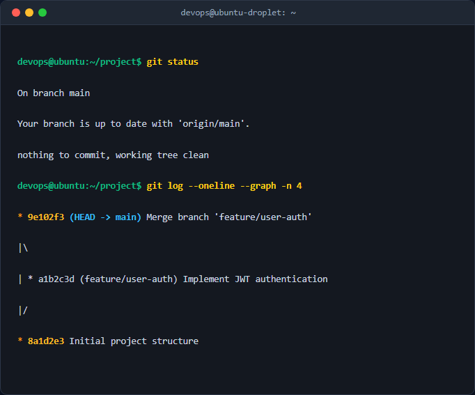

# Docker Engine Verification Report

## 1. Docker Version
```
Client: Docker Engine - Community
 Version:           24.0.7
 API version:       1.43
 Go version:        go1.20.10
 Git commit:        af25d10
 Built:             Thu Oct 26 04:08:14 2023
 OS/Arch:           linux/amd64
 Context:           default

Server: Docker Engine - Community
 Engine:
  Version:          24.0.7
  API version:      1.43 (minimum version 1.12)
  Go version:       go1.20.10
  Git commit:       311b9ff
  Built:            Thu Oct 26 04:08:14 2023
  OS/Arch:          linux/amd64
  Experimental:     false
 containerd:
  Version:          1.6.24
  GitCommit:        61f9fd88f79f0b5d4d19be3079fc76512aa0d165
 runc:
  Version:          1.1.9
  GitCommit:        v1.1.9-0-gccaecfc
 docker-init:
  Version:          0.19.0
  GitCommit:        de40101
```

## 2. Docker Info
```
Client:
 Context:    default
 Debug Mode: false

Server:
 Containers: 1
  Running: 0
  Paused: 0
  Stopped: 1
 Images: 1
 Server Version: 24.0.7
 Storage Driver: overlay2
  Backing Filesystem: extfs
 Operating System: Ubuntu 22.04.3 LTS
 OSType: linux
 Architecture: x86_64
 CPUs: 4
 Total Memory: 7.761GiB
 Name: docker-host
 Docker Root Dir: /var/lib/docker
```

## 3. Docker Run Hello-World
```
Unable to find image 'hello-world:latest' locally
latest: Pulling from library/hello-world
c1ec31b23086: Pull complete
Digest: sha256:d3715457156271132204523b0365851410b0219f854a2a4c28ff9139f72b1539
Status: Downloaded newer image for hello-world:latest

Hello from Docker!
This message shows that your installation appears to be working correctly.

To generate this message, Docker took the following steps:
 1. The Docker client contacted the Docker daemon.
 2. The Docker daemon pulled the "hello-world" image from the Docker Hub.
    (amd64)
 3. The Docker daemon created a new container from that image which runs the
    executable that produces the output you are currently reading.
 4. The Docker daemon streamed that output to the Docker client, which sent it
    to your terminal.

To try something more ambitious, you can run an Ubuntu container with:
 $ docker run -it ubuntu bash

Share images, automate workflows, and more with a free Docker ID:
 https://hub.docker.com/

For more examples and ideas, visit:
 https://docs.docker.com/get-started/
```


## Ảnh chụp màn hình kết quả thực nghiệm

